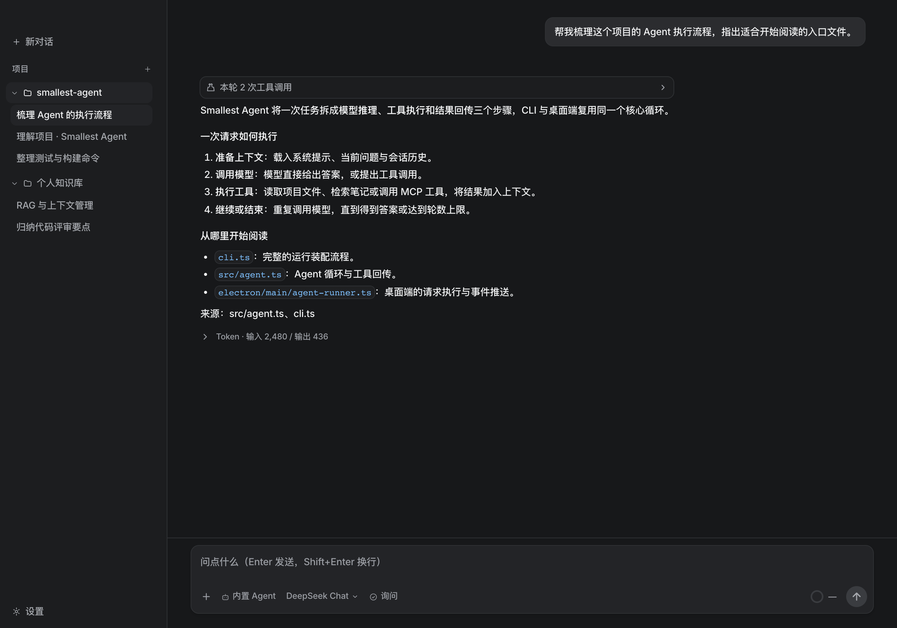
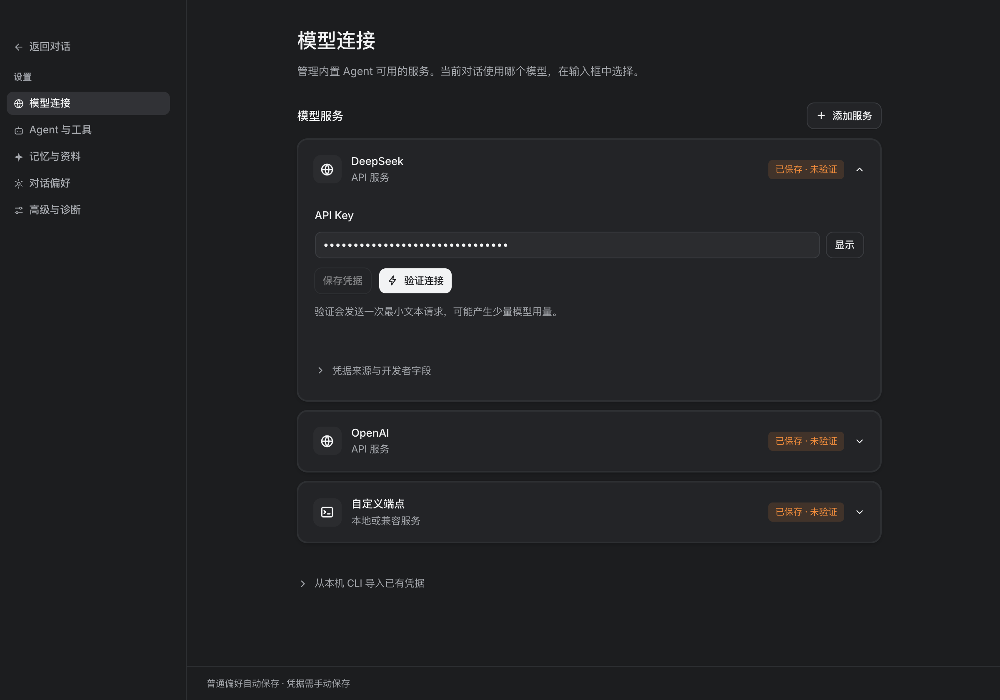
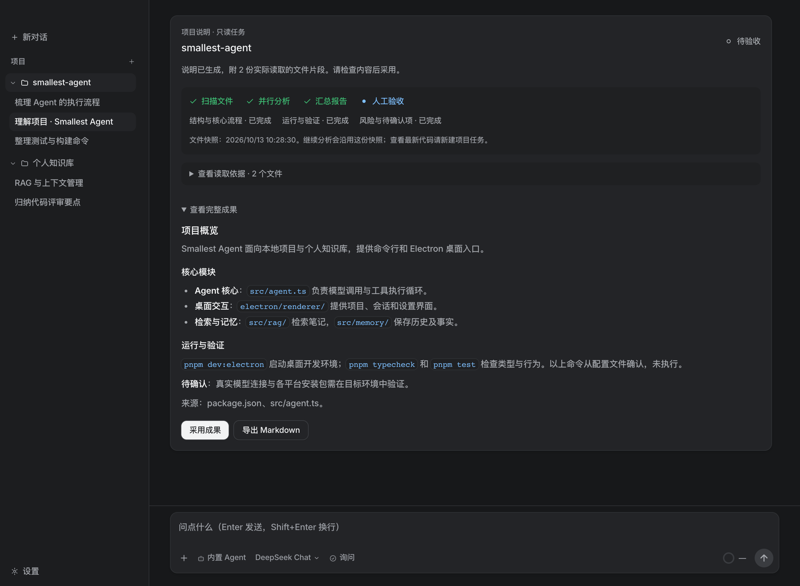
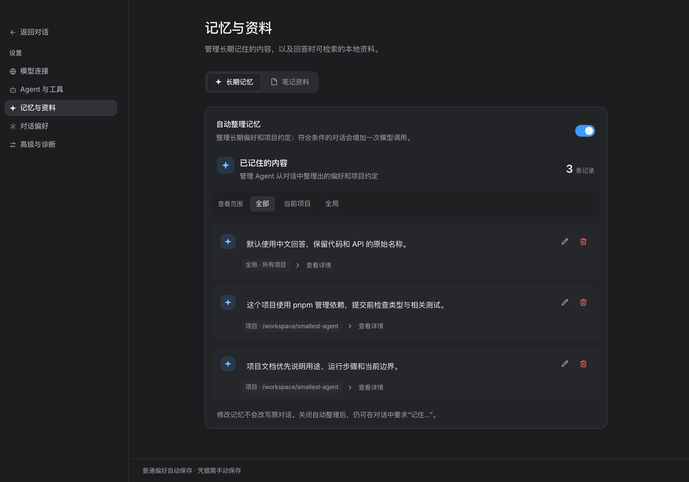

# Smallest Agent

Smallest Agent 是一个面向本地项目与个人知识库的 AI 助手，提供 Electron 桌面应用和命令行入口。它支持项目文件交互、笔记检索、跨会话记忆，以及通过 MCP 和 ACP 扩展工具与 Agent。

TypeScript 版本以可独立运行的 Agent 循环为核心，桌面端与 CLI 共用模型调用、工具执行和记忆模块。仓库同时包含 Rust 核心、Rust CLI 与 GPUI 桌面实现。

[快速开始](#快速开始) · [界面与使用说明](#界面与使用说明) · [配置](#配置) · [开发与验证](#开发与验证) · [项目结构](#项目结构)



*界面预览：在项目中提问、查看工具轨迹与文件来源，并在输入区选择 Agent、模型和权限。本文截图由当前 Electron 渲染界面生成，使用演示项目、会话和配置数据；回答、用量及任务状态均为展示示例，不代表真实模型调用或验证结果。*

## 主要功能

- **项目与会话管理**：按项目组织对话，保存历史，并为项目会话提供文件访问能力。
- **项目理解**：从新对话发起只读分析，生成项目说明，查看实际读取的文件依据，确认采用或导出 Markdown。
- **模型与 Agent 接入**：配置内置模型服务或自定义端点，通过 ACP（Agent Client Protocol）连接外部 Agent。
- **工具与技能**：通过 MCP（Model Context Protocol）发现和调用工具，按需加载 Markdown 技能；桌面端支持网页搜索与内容获取。
- **本地知识检索**：对 Markdown 笔记进行切块、本地向量化和语义检索，回答可标注来源。
- **记忆与上下文管理**：保存会话历史，压缩较早的消息，维护全局及项目范围的事实记忆。
- **附件与执行反馈**：桌面端支持图片、PDF 和文本附件，展示流式回答、工具调用、权限请求及模型返回的用量信息。
- **运行与评估**：提供重试、备用模型、磁盘缓存、答案证据核查，以及程序化和模型评分的评估工具。

以上主要描述 TypeScript / Electron 版本。不同入口的工具、配置和界面能力有所区别，Rust 版本单独构建。

## 快速开始

### 环境要求

- Node.js 22（22.12.0 或更高版本）或 Node.js 24。
- pnpm 10；本机需可执行 `npx`，用于启动 MCP 服务。
- 可用的模型 API 凭据；使用外部 ACP Agent 时，需完成对应服务的安装或认证。

以下命令均在仓库根目录执行。

### 安装依赖

```bash
pnpm install
```

### 启动桌面应用

```bash
pnpm dev:electron
```

1. 打开设置，在「模型服务」中配置服务和 API Key，保存后可点击「验证连接」。
2. 新建对话，选择模型并发送问题。
3. 需要处理本地项目时，选择项目目录；点击「理解项目」可生成带文件依据的项目说明。

桌面界面可以在未配置 API Key 时启动，调用内置模型前需完成配置。笔记检索模型在首次检索时加载，扩展工具在后台连接。

### 使用命令行

首次使用时创建配置文件；已有 `.env` 时直接编辑即可：

```bash
cp .env.example .env
```

在 `.env` 中填写模型连接信息：

```dotenv
DEEPSEEK_API_KEY=your-api-key
DEEPSEEK_BASE_URL=https://api.deepseek.com/v1
DEEPSEEK_MODEL=deepseek-chat
```

运行一次对话：

```bash
pnpm dev "根据我的笔记，解释 RAG 的工作流程，并注明来源"
```

CLI 会在运行前加载本地 embedding 模型、索引笔记并连接 MCP 服务。首次运行可能需要下载模型文件。

使用相同的 `SESSION_ID` 继续对话：

```bash
SESSION_ID=demo pnpm dev "这个项目使用 TypeScript"
SESSION_ID=demo pnpm dev "这个项目使用什么语言？"
```

## 界面与使用说明

### 项目工作区与对话

左侧按本地项目组织会话，右侧展示当前对话的消息、工具记录和输入区域。新对话会归入当前选中的项目，便于把代码分析、资料整理和日常问答分开管理。

| 界面区域 | 可以做什么 |
| --- | --- |
| 项目与会话列表 | 添加本地目录、切换对话，通过右键菜单重命名或删除会话 |
| 工具调用记录 | 展开调用参数和工具返回内容，了解回答依据 |
| 回答区域 | 阅读 Markdown、代码块与来源，查看模型返回的用量信息 |
| 输入区 | 添加附件、切换 Agent 与模型、选择内置 Agent 的权限模式 |
| 设置 | 管理模型连接、Agent 与工具、记忆与资料、对话偏好和运行限制 |

可以从一个具体问题开始，例如：

> 帮我梳理这个项目的 Agent 执行流程，指出适合开始阅读的入口文件。

### 模型连接与选择



在「设置 → 模型连接」中添加服务，填写并保存凭据。自定义服务可填写兼容 API 地址和模型清单；保存服务配置后，在对话输入区选择本轮使用的模型。

- **保存凭据**：保存该服务的连接配置，不等于已经验证可用。
- **验证连接**：发送一次最小文本请求，检查当前连接；可能产生少量 API 用量，不能代替图片、PDF 或工具调用能力验证。
- **切换模型**：在对话输入区选择已配置的服务与模型。
- **使用外部 Agent**：在「Agent 与工具」中启用相应引擎，再回到对话中选择；外部引擎的安装、登录和权限由其自身管理。

### 项目文件与权限



从新对话点击「选择项目并开始」，或在已选项目中点击「理解项目」。任务按阶段生成说明，最终由用户检查并验收：

| 阶段 | 界面与操作 |
| --- | --- |
| 扫描文件 | 读取项目文件，保存本次分析使用的文件快照 |
| 并行分析 | 分别整理项目结构、运行与验证方法、风险及待确认项 |
| 汇总报告 | 生成完整说明，并保留实际读取的文件片段 |
| 人工验收 | 展开「查看读取依据」和「查看完整成果」，确认后点击「采用成果」，或导出 Markdown |

任务支持停止并保存进度；已停止或失败的任务可通过「继续分析」恢复。恢复时沿用原文件快照，要分析最新代码需新建任务。

Electron 内置 Agent 的文件工具以会话所属的项目目录为访问范围；未选择项目的会话不加载项目文件工具。会话提供「只读」「询问」「自动」三种权限模式，默认在执行受控写操作前请求确认。

「理解项目」是只读分析，不修改项目文件，也不执行报告中的命令。「采用成果」仅标记验收状态；文件依据是分析时保存的片段，不代表所有结论均已验证。

TypeScript CLI 的文件工具默认访问 `./notes`，可通过 `MCP_FS_DIR` 修改。该入口直接加载 filesystem MCP 的读写工具，不使用桌面端的审批界面。

### 长期记忆



在「设置 → 记忆与资料 → 长期记忆」中查看 Agent 已整理的偏好和项目约定。记录可以按「全部」「当前项目」「全局」筛选，每条记忆均可编辑或忘记；忘记后界面提供撤销操作。

| 内容 | 适用范围 | 示例 |
| --- | --- | --- |
| 会话历史 | 当前对话 | 上一轮的问题、回答及工具调用 |
| 全局记忆 | 跨项目、跨会话 | 「默认使用中文回答，保留代码原名」 |
| 项目记忆 | 同一项目下的会话 | 「这个项目使用 pnpm 管理依赖」 |
| 笔记知识库 | 通过检索按需提供资料 | RAG 学习笔记、操作手册、项目文档 |

在对话中明确说「记住这个项目使用 pnpm」，可以让 Agent 记录项目约定。开启「自动整理记忆」后，系统也会按条件从对话中提取值得保留的事实，可能增加模型调用。关闭该开关后，仍可主动要求记忆；编辑记忆不会改写原对话。

### 知识库

`NOTES_DIR` 指定笔记目录，默认使用仓库内的 `notes/`。当前索引读取该目录下的 `.md` 文件，不递归扫描子目录；向量索引保存在内存中。

```dotenv
NOTES_DIR=/absolute/path/to/notes
EMBEDDING_MODEL=Xenova/multilingual-e5-small
```

embedding 在本地执行。首次使用会下载模型，也可通过 `LOCAL_MODEL_PATH` 指定已准备好的本地模型根目录；下载端点可通过 `HF_ENDPOINT` 配置。桌面端修改笔记目录或检索模型后，按设置提示重启应用以重建索引。

桌面端可在「设置 → 记忆与资料 → 笔记资料」选择目录。准备好资料后，可以提问「根据我的笔记，比较 RAG 与直接扩展上下文的适用场景，并注明来源」，再结合工具检索记录核对答案。

### 技能与外部 Agent

TypeScript 版本从 `skills/` 加载 Markdown 技能，模型通过 `list_skills` 和 `get_skill` 按需读取内容。例如：

```bash
pnpm dev "使用 code-review 技能评审：function add(a, b) { return a - b }"
```

桌面端可配置 ACP 外部 Agent 的启动命令、参数与环境变量。外部 Agent 使用自己的运行时和权限规则；本应用展示其通过 ACP 发出的内容与权限请求。

### 附件

桌面端支持图片、PDF、TXT、Markdown、CSV 和 JSON，也可仅发送附件。每条消息最多 10 个附件，单个不超过 20 MB，总计不超过 40 MB。图片和 PDF 的理解能力取决于选用的模型及 Agent；附件会随会话历史保存。

## 配置

TypeScript CLI 从环境变量和 `.env` 读取配置。常用选项如下，完整示例见 [`.env.example`](.env.example)，实际解析逻辑见 [`src/config.ts`](src/config.ts)。

| 变量 | 默认值 | 说明 |
| --- | --- | --- |
| `DEEPSEEK_API_KEY` | 无 | CLI 必填，模型服务 API Key |
| `DEEPSEEK_BASE_URL` | `https://api.deepseek.com/v1` | 模型 API 地址 |
| `DEEPSEEK_MODEL` | `deepseek-chat` | 主模型名称 |
| `TEMPERATURE` | `0` | 采样温度 |
| `MAX_TURNS` | `10` | 单次任务的最大 Agent 循环轮数 |
| `NOTES_DIR` | `./notes` | Markdown 笔记目录 |
| `EMBEDDING_MODEL` | `Xenova/multilingual-e5-small` | 本地 embedding 模型 |
| `SESSION_ID` | `default` | CLI 会话标识 |
| `SESSIONS_DIR` | `./.sessions` | CLI 会话存储目录 |
| `MAX_CONTEXT_TOKENS` | `2000` | 触发历史摘要压缩的估算 token 阈值 |
| `KEEP_RECENT` | `6` | 压缩时保留的最近消息条数 |
| `AUTO_EXTRACT_FACTS` | `1` | 自动提取事实记忆；`0` 关闭 |
| `FALLBACK_MODEL` | 与主模型相同 | 请求失败时使用的备用模型；与主模型相同时不切换 |
| `MAX_RETRIES` | `2` | 瞬时错误的最大重试次数 |
| `LLM_CACHE` | `1` | 模型结果缓存；`0` 关闭 |
| `LLM_CACHE_DIR` | `./.llm-cache` | CLI 缓存目录 |
| `STREAM` | `1` | 流式输出；`0` 关闭 |
| `MCP_FS_DIR` | `./notes` | CLI 文件系统工具的允许目录 |

Electron 的模型服务、自定义端点、检索、记忆和运行选项通过设置面板管理。桌面端按所选服务解析模型与凭据，并使用独立的会话和缓存目录；上表中的 CLI 路径默认值不适用于桌面端。

### 本地数据

| 数据 | TypeScript CLI | Electron |
| --- | --- | --- |
| 模型及运行配置 | `.env` / 环境变量 | 设置面板，持久化到 Electron `userData` |
| 会话历史 | `.sessions/` | `userData/sessions/` |
| 模型结果缓存 | `.llm-cache/` | `userData/llm-cache/` |
| 事实记忆 | `~/.smallest-agent/facts.json` | 与 TypeScript CLI 共用 |
| 评估报告 | `eval-results.json` | 通过根目录评估命令生成 |

Electron 的 API Key 使用本地明文配置保存。对话、附件及工具读取的内容可能随请求发送到所选模型服务；本地 embedding 不代表整个应用离线运行。模型结果缓存当前没有自动过期机制。

## 开发与验证

| 命令 | 用途 |
| --- | --- |
| `pnpm dev "问题"` | 运行 TypeScript CLI |
| `pnpm dev:electron` | 启动 Electron 开发环境 |
| `pnpm typecheck` | TypeScript 类型检查 |
| `pnpm test` | 运行核心与 Electron 测试 |
| `pnpm test:watch` | 监听模式运行测试 |
| `pnpm eval` | 调用真实模型运行评估用例 |
| `pnpm build:electron` | 构建桌面应用到 `out/` |
| `pnpm preview:electron` | 预览已构建的桌面应用 |

修改代码后可运行：

```bash
pnpm typecheck
pnpm test
pnpm build:electron
```

测试包含真实 MCP 子进程的集成测试，需要 `npx` 和对应依赖可用。`pnpm eval` 使用真实模型与检索工具，会产生 API 用量，并将结果写入 `eval-results.json`；评估用例位于 [`evals/cases.ts`](evals/cases.ts)。

### 打包桌面应用

在具备对应平台构建条件的环境中运行：

| 命令 | 配置的产物格式 |
| --- | --- |
| `pnpm package:mac` | DMG、ZIP |
| `pnpm package:win` | NSIS 安装包、Portable |
| `pnpm package:linux` | AppImage |

产物输出至 `dist-electron/`。构建与打包配置位于 [`electron.vite.config.ts`](electron.vite.config.ts) 和 [`package.json`](package.json)。

### Rust / GPUI 版本

`rs/` 是独立的 Cargo workspace，包含 `smallest-agent-core`、`smallest-agent-cli` 和 `smallest-agent-ui`。需要支持 Rust 2024 edition 的工具链；GPUI 桌面端还依赖对应平台的原生构建环境，并会获取 Git 依赖。

在仓库根目录准备好 `.env` 后，可运行：

```bash
# 命令行
cargo run --manifest-path rs/Cargo.toml -p smallest-agent-cli -- "你好"

# GPUI 桌面端
cargo run --manifest-path rs/Cargo.toml -p smallest-agent-ui

# 核心测试
cargo test --manifest-path rs/Cargo.toml -p smallest-agent-core
```

Rust 版本独立解析配置，不保证与 TypeScript 版本的环境变量行为完全一致。自定义模型端点使用 `CUSTOM_BASE_URL`、`CUSTOM_API_KEY` 和 `CUSTOM_MODELS`，详见 [`.env.example`](.env.example) 与 [`rs/core/src/config.rs`](rs/core/src/config.rs)。

## 项目结构

```text
smallest-agent/
├── cli.ts                 TypeScript 命令行入口
├── eval.ts                真实模型评估入口
├── mcp-server.ts          内置 MCP 服务：天气与技能工具
├── src/
│   ├── agent.ts           Agent 循环
│   ├── llm.ts             模型调用与流式响应
│   ├── tools/             工具执行、检索、记忆与网页工具
│   ├── rag/               文本切块、本地 embedding 与向量检索
│   ├── memory/            会话存储、摘要压缩与事实记忆
│   ├── mcp/               MCP 客户端
│   └── eval/              评估执行与评分
├── electron/
│   ├── main/              主进程、Agent 运行时与 IPC
│   ├── renderer/          React 界面
│   └── shared/            共享类型与通信协议
├── rs/                    Rust 核心、CLI 与 GPUI 界面
├── skills/                Markdown 技能
├── notes/                 示例知识库
├── evals/                 评估用例
├── tests/                 核心与桌面端测试
├── docs/                  产品说明与设计记录
└── beautiful-ui/          独立 UI 组件演示项目
```

核心执行流程为：加载配置与历史 → 调用模型 → 执行工具并回传结果 → 继续调用模型或输出答案 → 保存会话。模型调用、工具注册表和持久化通过依赖注入连接，便于扩展与测试。

## 常见问题

**Electron 提示安装不完整**

项目已通过 `pnpm.onlyBuiltDependencies` 允许 Electron 安装脚本。如果运行时二进制仍缺失，可在安装依赖后执行：

```bash
node node_modules/electron/install.js
```

**首次检索耗时较长或模型下载失败**

首次使用需要下载 embedding 模型并构建索引。检查模型下载网络，或配置 `HF_ENDPOINT` / `LOCAL_MODEL_PATH`。Electron 中的检索初始化失败只影响笔记检索，下次调用会重新尝试。

**桌面端无法读取项目文件**

确认会话已关联项目，目录可访问，且应用能够执行 `npx` 启动 filesystem MCP 服务。已打包的应用仍需要该外部文件服务可用。

**附件已添加，但模型无法理解**

附件选择与模型能力是独立的。请选择支持相应图片或 PDF 输入的模型；使用 ACP 时还需外部 Agent 声明对应能力。

更多项目任务、附件和启动行为说明见[项目理解与首次体验交付说明](docs/product/2026-09-09-phase-one.md)。
